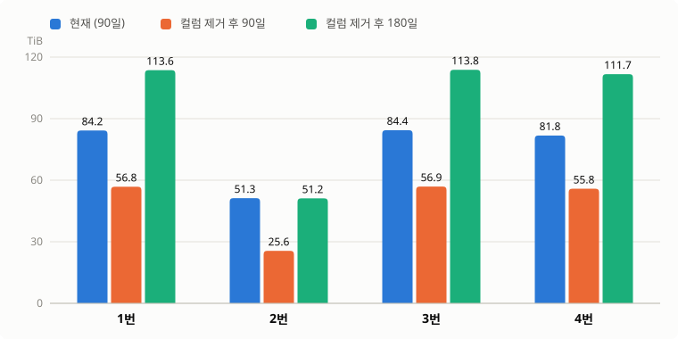
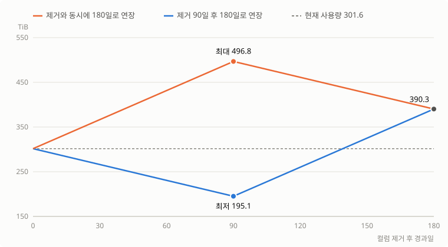

# 빅테이블 array 컬럼 제거 용량 산정

| 항목 | 내용 |
|------|------|
| 대상 | 빅테이블 4개 (수직분할 1~4번) |
| 제거 컬럼 | array&lt;double&gt; value 컬럼. 1·2번 1개, 3·4번 2개 (파티션·Sort Order 컬럼 아님) |
| 기준 | 운영 `$files` 하루치 1일 (daily Compaction 완료일), Trino 482 조회 |
| 보관일수 | 현재 90일, 검토안 180일 |
| 단위 | TiB (1024⁴ B) |

---

## 1. 결론

| 구분 | 4개 합계 | 현재 대비 |
|------|---------|----------|
| 현재 (90일) | 301.6 TiB | |
| 컬럼 제거 후 90일 | 195.1 TiB | −106.5 TiB (−35.3%) |
| 컬럼 제거 후 180일 | 390.3 TiB | +88.6 TiB (+29.4%) |

- 하루 용량 3.351 TiB 중 1.183 TiB(35.3%)가 제거 대상 컬럼이다
- 보관일수를 180일로 늘리면 현재보다 88.6 TiB가 더 필요하다. 지금 용량(301.6 TiB) 안에서는 **139일**까지 보관할 수 있다
- 2번 테이블은 제거 컬럼이 하루 용량의 50.1%라서, 180일로 늘려도 현재 90일과 같은 용량이다(51.3 → 51.2 TiB)
- 기존 90일치는 `DROP COLUMN`만으로는 줄지 않는다. **rewrite + expire snapshots로 줄이면 180일 연장을 바로 적용**할 수 있고(90일치 rewrite 비용), rewrite하지 않으면 **컬럼 제거 90일 뒤에 연장**한다. 아무 처리 없이 바로 늘리면 90일째에 496.8 TiB까지 올라간다 (§3)

---

## 2. 테이블별 용량



### 2.1 하루치

| 테이블 | 제거 컬럼 | 파일 수 | 현재 | 제거 컬럼 | 제거 후 | 절감률 |
|--------|----------|--------|------|----------|--------|--------|
| 1번 | 1개 | 2,622 | 0.936 | 0.305 | 0.631 | 32.5% |
| 2번 | 1개 | 1,619 | 0.569 | 0.285 | 0.284 | 50.1% |
| 3번 | 2개 | 1,931 | 0.937 | 0.305 | 0.632 | 32.6% |
| 4번 | 2개 | 1,868 | 0.909 | 0.288 | 0.621 | 31.7% |
| **합계** | | 8,040 | **3.351** | **1.183** | **2.168** | **35.3%** |

1번은 컬럼 1개, 3번은 컬럼 2개를 빼지만 절감량은 같다(각 약 312 GiB). 1번의 제거 컬럼 1개가 3번의 2개만큼 크다.

### 2.2 보관일수 적용

| 테이블 | 현재 (90일) | 제거 후 90일 | 차이 | 제거 후 180일 | 차이 | 현재 용량으로 보관 가능 |
|--------|-----------|------------|------|-------------|------|----------------------|
| 1번 | 84.2 | 56.8 | −27.4 | 113.6 | +29.4 | 133일 |
| 2번 | 51.3 | 25.6 | −25.7 | 51.2 | −0.1 | 180일 |
| 3번 | 84.4 | 56.9 | −27.5 | 113.8 | +29.4 | 133일 |
| 4번 | 81.8 | 55.8 | −25.9 | 111.7 | +29.9 | 131일 |
| **합계** | **301.6** | **195.1** | **−106.5** | **390.3** | **+88.6** | **139일** |

1번으로 계산 과정을 보이면 다음과 같다.

1. 하루치 0.936 TiB 중 제거 컬럼이 0.305 TiB → 제거 후 하루치 0.631 TiB
2. 현재 90일: 0.936 × 90 = 84.2 TiB
3. 제거 후 90일: 0.631 × 90 = 56.8 TiB (−27.4)
4. 제거 후 180일: 0.631 × 180 = 113.6 TiB (현재 대비 +29.4)
5. 현재 용량으로 보관 가능한 일수: 84.2 ÷ 0.631 = 133일

---

## 3. 기존 데이터 처리와 180일 연장 시점

컬럼 제거(`DROP COLUMN`)는 메타데이터만 바꾼다. 새로 쓰는 파일부터 작아지고, 제거 시점에 있는 90일치(301.6 TiB)는 그대로 남는다. 기존 데이터를 처리하는 방법은 두 가지다.

| 방법 | 기존 90일치 | 180일 연장 | 최대 용량 | 비용 |
|------|-----------|-----------|----------|------|
| A. rewrite + expire snapshots | 컬럼 없이 다시 쓰고, 옛 파일은 snapshot 보존 3일 뒤 삭제 | 바로 적용 | 390.3 (하루 rewrite 12일치 이하) | 90일치 rewrite |
| B. 보관일수 경과로 삭제 | 90일 기준으로 삭제될 때까지 둔다 | 제거 90일 뒤 | 390.3 | 없음 |
| 처리 없이 바로 연장 | 180일 기준으로 바뀌어 90일 더 남는다 | 바로 적용 | **496.8** | 없음 |

A와 B의 최종 용량은 390.3 TiB로 같다. 차이는 기존 90일치를 180일까지 보관하는지다.

- A: 기존 90일치도 180일 동안 남는다. 컬럼 제거 90일 뒤에 180일치가 모두 찬다
- B: 기존 90일치는 90일 기준으로 지워진다. 180일치가 모두 차는 시점은 컬럼 제거 180일 뒤다

### 3.1 A. rewrite + expire snapshots

- expire snapshots만 돌리면 줄지 않는다. 현재 snapshot이 옛 파일을 그대로 참조하기 때문이다. rewrite로 현재 snapshot을 새 파일로 바꾼 뒤에야 expire가 옛 파일을 지운다
- rewrite는 현재 스키마로 쓰므로 제거 컬럼이 빠진다 (로컬 확인 91,902,234 → 61,850,566 B, §4.2)
- 대상은 기존 90일치 전체다. hourly Compaction과 같은 설정(`sort`, `rewrite-all=true`)에 날짜 범위만 지정한다

옛 파일은 rewrite 뒤 snapshot 보존 3일 동안 남는다. 하루에 많이 rewrite할수록 "3일 동안 다시 쓴 일수 × 3.351 TiB"가 겹쳐서 일시적으로 커진다.

| 하루 rewrite 일수 | 완료 | 최대 용량 |
|------------------|------|----------|
| 10일치 | 9일 | 390.3 (최종값, 3일째 373.1) |
| 13일치 | 7일 | 392.7 (3일째) |
| 20일치 | 4.5일 | 438.2 (3일째) |
| 30일치 | 3일 | 503.3 (3일째) |

- snapshot 보존 3일은 재처리 DAG의 전제(보존 3일 > 재처리 조회 2일)라 줄이지 않는다
- 시간 규모: 1번 hourly Compaction 실측 2.41초/GB(executor 12대) 기준이면 하루치 4개 테이블(3,431 GiB)에 약 2.3시간, 90일치에 약 207시간이다. 같은 리소스로는 하루 10일치가 23시간이라, 리소스를 늘리지 않으면 완료까지 수 주가 걸린다
- 이 시간은 small file 입력 기준 실측을 옮긴 추정이다. 1일치 시험 rewrite로 실제 시간을 잰 뒤 진행 속도를 정한다

### 3.2 B. 보관일수 경과로 삭제



| 컬럼 제거 후 경과일 | 0일 | 90일 | 139일 | 180일 |
|-------------------|-----|------|-------|-------|
| 처리 없이 바로 180일로 연장 | 301.6 | **496.8 (최대)** | 438.8 | 390.3 |
| 제거 90일 뒤 180일로 연장 (B) | 301.6 | 195.1 (최저) | 301.4 | 390.3 |

**처리 없이 바로 연장하면** 기존 90일치가 180일 기준으로 바뀌어 90일 더 남는다.

- 90일째: 기존 데이터 301.6 + 새 데이터 90일 × 2.168 = 195.1 → **496.8 TiB**
- 이후 기존 데이터가 하루씩 삭제되며 180일째 390.3 TiB로 내려온다

**제거 90일 뒤 연장하면(B)** 기존 데이터가 90일 기준으로 모두 삭제된 뒤 늘어난다.

- 90일째: 새 데이터만 남아 195.1 TiB
- 이후 하루 2.168 TiB씩 늘어 139일째(301.6 ÷ 2.168 = 139.1)에 현재 용량에 닿고, 180일째 390.3 TiB에서 멈춘다

> 보관일수는 `ts` 기준 N일이 지난 데이터를 삭제하는 방식으로 가정했다.

---

## 4. 산정 방법과 검증

### 4.1 원리

Iceberg는 데이터 파일을 쓸 때 컬럼별 크기를 메타데이터(`$files`의 `column_sizes`, `readable_metrics`)에 기록한다.

- `column_size` = 데이터 파일 안에서 그 컬럼이 차지하는 **압축 후(zstd) 바이트**. 값 데이터, dictionary, array 구조 정보(repetition/definition level)를 포함한다 (Iceberg 1.10.1 `ParquetMetrics`, Parquet `ColumnChunkMetaData.getTotalSize()`)
- 파일 크기 = 전체 컬럼의 `column_size` 합 + footer + page index
- Parquet은 컬럼별로 따로 압축하므로, 컬럼을 빼도 나머지 컬럼의 크기는 변하지 않는다. 줄어드는 양 = 제거 컬럼의 `column_size` 합

> ⚠️ `write.metadata.metrics.column.val_arr_1 = 'none'`은 실제 값이 들어 있는 하위 컬럼 `val_arr_1.element`에 적용되지 않는다. 그래서 `none`을 설정한 array 컬럼도 `column_size`가 기록된다. 키를 `val_arr_1.element`로 바꾸면 `column_size`가 null이 되어 이 방법으로 산정할 수 없다.

### 4.2 검증

**① 로컬 테스트**: 컬럼을 제거하고 다시 쓴 실제 크기가 예측과 0.02% 차이

- 환경: Claude Code 클라우드 세션 컨테이너. PySpark 3.5.8 + `iceberg-spark-runtime-3.5_2.12-1.10.1`, `local[2]`, HadoopCatalog, 로컬 디스크
- 테이블: 파티션 `hours(ts)`, `par_a`, Sort Order, zstd, array&lt;double&gt; 3개(운영과 같은 `none` 설정 포함), 20만 row
- 절차: 컬럼 1개 `DROP COLUMN` → sort `rewrite_data_files`(rewrite-all) → 크기 비교

| 항목 | 값 |
|------|-----|
| 제거 전 전체 크기 | 91,902,234 B |
| 제거 컬럼 `column_size` 합 | 30,039,786 B |
| 예측 (전체 − 제거 컬럼) | 61,862,448 B |
| 다시 쓴 실제 크기 | 61,850,566 B |
| 차이 | 11,882 B (0.02%, 파일 2개 → 1개로 줄어든 footer 몫) |

`DROP COLUMN` 직후 rewrite 전 크기는 91,902,234 B 그대로였다 (§3의 전제).

**② 운영 gap 확인**: 파일별 `file_size_in_bytes − column_sizes 합`

| 테이블 | gap 최소 | gap 최대 |
|--------|---------|---------|
| 1번 | 5,817 B | 87,953 B |
| 2번 | 5,467 B | 101,258 B |
| 3번 | 6,288 B | 91,557 B |
| 4번 | 6,408 B | 92,901 B |

최대 101,258 B는 512 MB 파일 기준 0.02%로, footer와 page index 크기다. array 컬럼 크기가 빠진 파일이 있었다면 gap이 MB 단위로 나온다.

**③ 운영 컬럼 수 확인**: 파일별 `cardinality(column_sizes)`가 테이블 컬럼 수와 같음

### 4.3 운영 조회 결과 (원본)

| 테이블 | files | total_bytes | drop_bytes |
|--------|-------|-------------|------------|
| 1번 | 2,622 | 1,028,949,472,691 | 334,909,162,505 |
| 2번 | 1,619 | 626,161,707,715 | 313,709,343,663 |
| 3번 | 1,931 | 1,030,754,375,464 | 335,558,471,727 |
| 4번 | 1,868 | 999,083,778,664 | 316,812,871,027 |

### 4.4 쿼리 (Trino 482)

`partition.ts_hour` 타입이 미확인이라 날짜를 파일 경로로 거른다. 날짜는 daily Compaction이 끝난 날로 한다.

**산정 (1·2번, 제거 컬럼 1개)**

```sql
SELECT count(*)                AS files,
       sum(file_size_in_bytes) AS total_bytes,
       sum(CAST(json_extract_scalar(readable_metrics, '$["<컬럼1>.element"].column_size') AS bigint)) AS drop_bytes
FROM iceberg.<스키마>."<테이블>$files"
WHERE file_path LIKE '%/ts_hour=<yyyy-MM-dd>-%'
```

**산정 (3·4번, 제거 컬럼 2개)**

```sql
SELECT count(*)                AS files,
       sum(file_size_in_bytes) AS total_bytes,
       sum(CAST(json_extract_scalar(readable_metrics, '$["<컬럼1>.element"].column_size') AS bigint))
     + sum(CAST(json_extract_scalar(readable_metrics, '$["<컬럼2>.element"].column_size') AS bigint)) AS drop_bytes
FROM iceberg.<스키마>."<테이블>$files"
WHERE file_path LIKE '%/ts_hour=<yyyy-MM-dd>-%'
```

**검증 (gap, 컬럼 수)**

```sql
SELECT min(file_size_in_bytes - reduce(map_values(column_sizes), BIGINT '0', (s, x) -> s + x, s -> s)) AS gap_min,
       max(file_size_in_bytes - reduce(map_values(column_sizes), BIGINT '0', (s, x) -> s + x, s -> s)) AS gap_max,
       min(cardinality(column_sizes)) AS min_cols,
       max(cardinality(column_sizes)) AS max_cols
FROM iceberg.<스키마>."<테이블>$files"
WHERE file_path LIKE '%/ts_hour=<yyyy-MM-dd>-%'
```

---

## 5. 산정에 포함하지 않은 것

| 항목 | 내용 |
|------|------|
| snapshot 보존분 | Compaction으로 대체된 파일이 snapshot 보존 3일 동안 남는 몫. `$files`는 현재 snapshot 파일만 보여준다 |
| 스토리지 복제 배수 | MinIO erasure coding 등 물리 저장 배수. 이 문서는 파일 크기(논리 용량) 기준 |
| 일별 변동 | 하루치 1일 기준이다. 데이터 증가는 반영하지 않았다 |

## 6. 적용 전 확인 사항

- **append 앱**: 입력 avro에는 제거한 컬럼이 그대로 있다. 앱이 테이블에 없는 컬럼을 넘기면 쓰기가 실패할 수 있다
- **조회 쿼리**: 제거한 컬럼을 SELECT하는 Trino 쿼리는 실패한다
- **튜닝값 재검증**: 파일이 작아지면 hourly Compaction의 ratio 0.13·`C=0.32`와 append executor 수 산정의 입력이 바뀐다 (`tuning/compaction-tuning-guide.md`, `tuning/append-tuning-test.md`)

---

## 7. 엑셀 붙여넣기용

탭으로 구분된 값이다. 코드 블록 오른쪽 위 복사 버튼으로 복사해 엑셀 셀 하나에 붙여 넣으면 열이 나뉜다. TiB = bytes ÷ 1024⁴ (엑셀 `=D2/1024^4`).

**하루치**

```text
테이블	제거 컬럼 수	파일 수	현재(bytes)	현재(TiB)	제거 컬럼(bytes)	제거 컬럼(TiB)	제거 후(bytes)	제거 후(TiB)	절감률
1번	1	2622	1028949472691	0.936	334909162505	0.305	694040310186	0.631	32.5%
2번	1	1619	626161707715	0.569	313709343663	0.285	312452364052	0.284	50.1%
3번	2	1931	1030754375464	0.937	335558471727	0.305	695195903737	0.632	32.6%
4번	2	1868	999083778664	0.909	316812871027	0.288	682270907637	0.621	31.7%
합계		8040	3684949334534	3.351	1300989848922	1.183	2383959485612	2.168	35.3%
```

**보관일수 적용**

```text
테이블	현재 90일(bytes)	현재 90일(TiB)	제거 후 90일(bytes)	제거 후 90일(TiB)	제거 후 180일(bytes)	제거 후 180일(TiB)	180일 - 현재(TiB)
1번	92605452542190	84.2	62463627916740	56.8	124927255833480	113.6	+29.4
2번	56354553694350	51.3	28120712764680	25.6	56241425529360	51.2	-0.1
3번	92767893791760	84.4	62567631336330	56.9	125135262672660	113.8	+29.4
4번	89917540079760	81.8	61404381687330	55.8	122808763374660	111.7	+29.9
합계	331645440108060	301.6	214556353705080	195.1	429112707410160	390.3	+88.6
```
